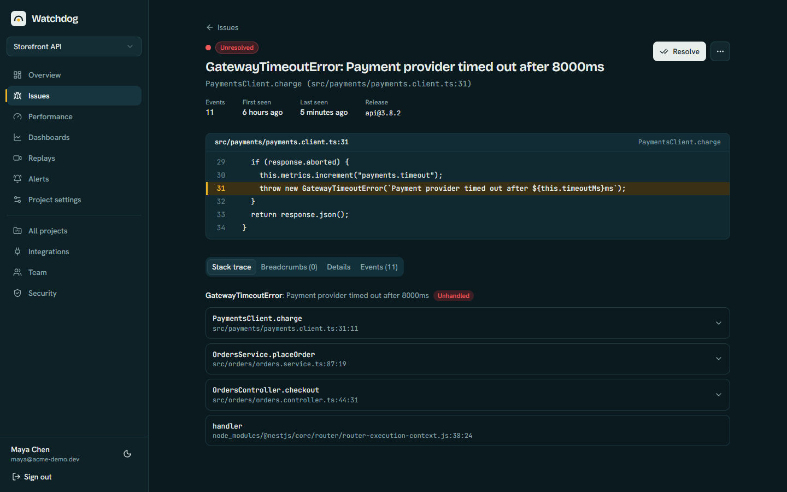
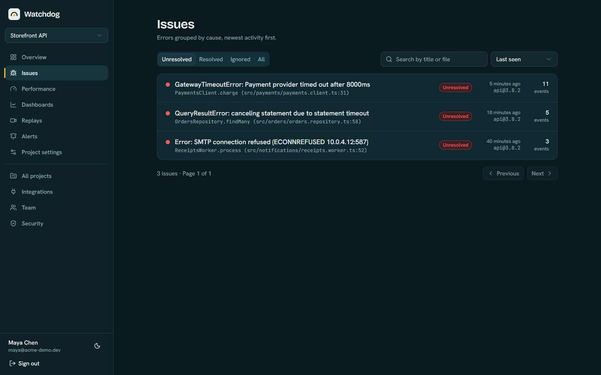
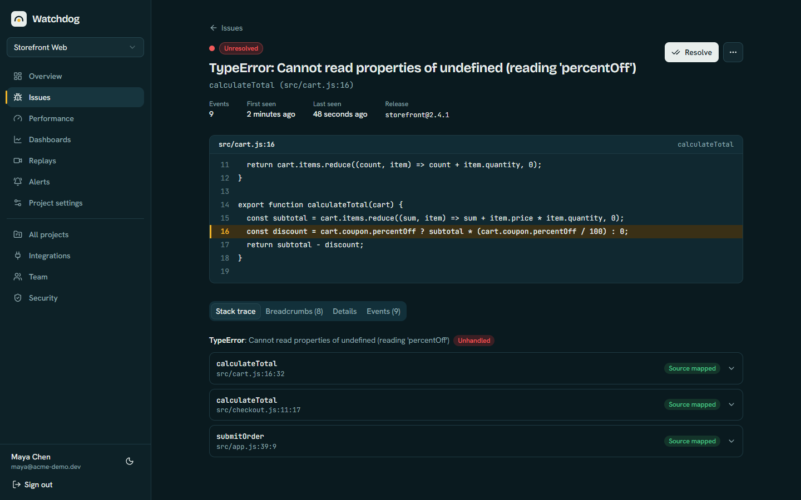
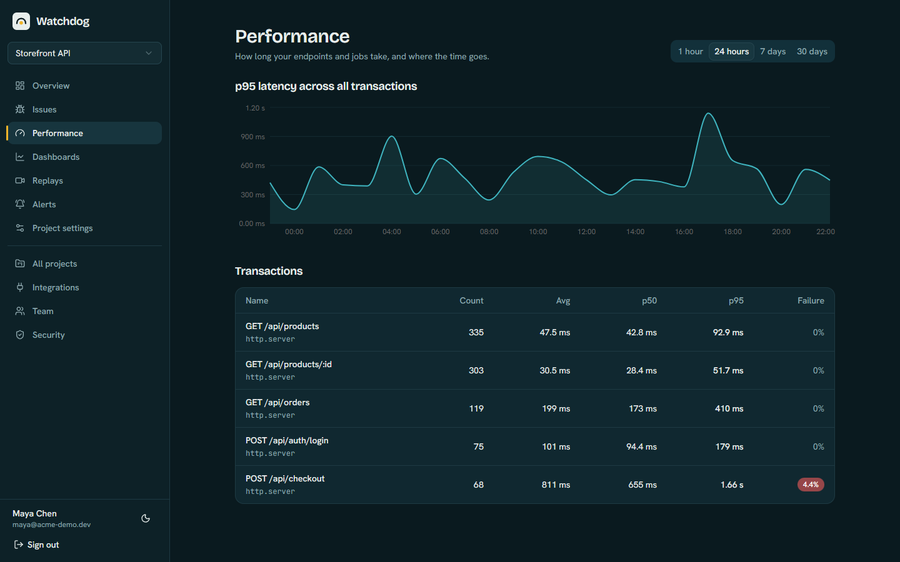
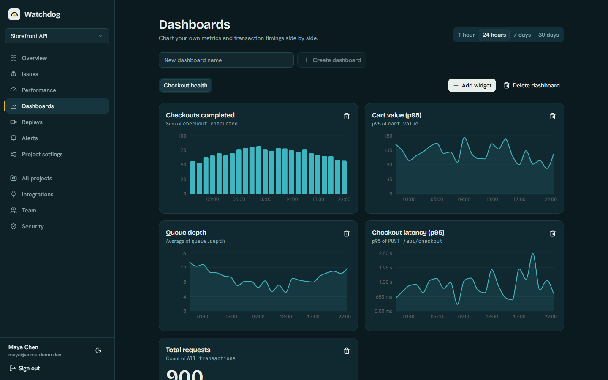
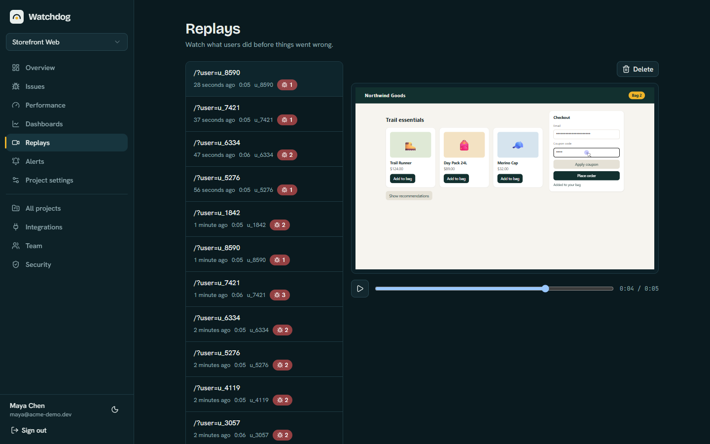
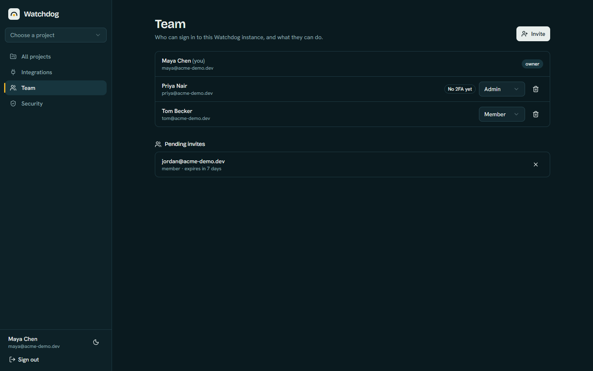

<div align="center">


# Watchdog

**The open-source, self-hosted Sentry alternative.**<br>
Error tracking, performance tracing and session replay in one container plus PostgreSQL.

[](https://railway.com/deploy/watch-dog?referralCode=TMZSr0&utm_medium=integration&utm_source=template&utm_campaign=generic)

[](https://www.npmjs.com/package/@watchdog-sdk/core)
[](https://github.com/Yassinos-coder/watchdog/actions/workflows/ci.yml)
[](LICENSE)

[Documentation](https://yassinos-coder.github.io/watchdog/) · [Watchdog vs Sentry](https://yassinos-coder.github.io/watchdog/sentry-alternative) · [Changelog](CHANGELOG.md)

</div>

Watchdog catches errors from your web, Node.js and React Native apps, shows you the original code behind every stack trace, times your endpoints, records sessions and alerts you where you work. It is free, MIT licensed and runs on your own infrastructure, so your data never leaves your servers.

<p align="center">
  
</p>

> **Early project (0.x).** It works and the author uses it, but expect rough edges, and it covers JavaScript and TypeScript apps only. See [what it does not do](https://yassinos-coder.github.io/watchdog/sentry-alternative).

## Features

- **Error tracking** with automatic grouping into issues, a resolved and ignored workflow, and regression detection
- **Real code lines**: upload source maps and see the original file, line and surrounding code for every frame
- **Performance tracing**: transactions, spans, custom metrics (counters, gauges, distributions) and dashboards with p50 and p95
- **Session replay** with inputs masked by default, linked to the errors that happened during the session
- **Alerts** to Slack, Discord, Telegram and email, using your own SMTP server
- **Teams**: invites, owner, admin and member roles, required two-step verification (authenticator app, passkey or emailed code) and sign in with Google or GitHub
- **SDKs** for browser, React, Node.js and NestJS, and React Native and Expo
- **Data retention** that deletes old events, traces and replays on a schedule
- **One container plus PostgreSQL**, Redis optional

## Screenshots

| | |
| --- | --- |
|  |  |
| **Issues**, grouped by cause | **Original code** from your source maps |
|  |  |
| **Performance** with p50 and p95 | **Dashboards** for your own metrics |
|  |  |
| **Session replay**, inputs masked | **Team**, roles and invites |

The screenshots show demo data from a sample storefront.

## What to expect

Watchdog is self-hosted, so it needs a little setup, and you run it. It is not a sign-up-and-go service. A first setup usually takes 15 to 30 minutes:

1. Deploy the app and its database (one click on Railway, or Docker anywhere).
2. Create the owner account with the setup token and add two-step verification.
3. Create a project and copy its DSN.
4. Add an SDK to your app and set the DSN as an environment variable.

Then upload source maps for readable stack traces, and add SMTP if you want invite emails. You are also responsible for updates and for backing up the database and your `WATCHDOG_SECRET_KEY`.

## Deploy on Railway

Click the button at the top. The template creates the app and a PostgreSQL database, generates the secrets and gives you a public address. Step-by-step notes are in the [Railway guide](docs/railway.md).

## Run it with Docker

```bash
git clone https://github.com/Yassinos-coder/watchdog.git
cd watchdog
cp .env.example .env
```

Edit `.env`: set `WATCHDOG_SECRET_KEY` (for example `openssl rand -hex 32`), set `APP_URL` to the address you will open Watchdog on, and optionally `SETUP_TOKEN`.

```bash
docker compose --profile app up -d
```

Open the app and follow the first-run setup. If you did not set `SETUP_TOKEN`, find it in the logs: `docker compose logs watchdog | grep "setup token"`.

## Send your first error

Create a project in the dashboard and copy its DSN. Install the SDK for your stack:

```bash
npm install @watchdog-sdk/react
```

```tsx
import * as Watchdog from '@watchdog-sdk/react';

Watchdog.init({ dsn: 'https://<key>@your-watchdog-host/<project-id>', release: '1.0.0' });

createRoot(root, Watchdog.reactRootErrorHandlers()).render(
  <Watchdog.WatchdogErrorBoundary fallback={<p>Something went wrong.</p>}>
    <App />
  </Watchdog.WatchdogErrorBoundary>,
);
```

```ts
// Node.js / NestJS
import * as Watchdog from '@watchdog-sdk/node';
import { expressTracing } from '@watchdog-sdk/node';
import { WatchdogExceptionFilter } from '@watchdog-sdk/node/nest';

Watchdog.init({ dsn: '...', release: process.env.APP_VERSION });
app.use(expressTracing());
// providers: [{ provide: APP_FILTER, useClass: WatchdogExceptionFilter }]
```

```tsx
// React Native and Expo
import * as Watchdog from '@watchdog-sdk/react-native';

Watchdog.init({ dsn: '...', release: '1.0.0' });
```

### See the real code, not minified bundles

Upload source maps from your build so stack traces show your original files:

```bash
WATCHDOG_URL=https://your-watchdog-host \
WATCHDOG_PROJECT_ID=<project-id> \
WATCHDOG_UPLOAD_TOKEN=<upload token from project settings> \
bunx @watchdog-sdk/cli sourcemaps upload ./dist --release 1.0.0
```

The `release` passed to the SDK and to the CLI must match.

## Packages

| Package | Purpose |
| --- | --- |
| `@watchdog-sdk/core` | Event model, stack parsing, tracing, metrics, retrying transport |
| `@watchdog-sdk/browser` | Global handlers, breadcrumbs, optional session replay |
| `@watchdog-sdk/react` | Error boundary, hooks and React 19 root handlers |
| `@watchdog-sdk/node` | Process handlers, request tracing, Express and NestJS integration |
| `@watchdog-sdk/react-native` | JavaScript crashes, breadcrumbs and navigation for React Native and Expo |
| `@watchdog-sdk/cli` | Source map upload |

## Configuration

| Variable | Required | Purpose |
| --- | --- | --- |
| `DATABASE_URL` | yes | PostgreSQL connection string |
| `WATCHDOG_SECRET_KEY` | yes | 32+ characters; encrypts stored secrets. Keep it stable and back it up |
| `APP_URL` | recommended | Public URL (also used for passkeys, invites and OAuth). Detected on Railway, Render, Fly and Koyeb |
| `SETUP_TOKEN` | recommended | Guards the first-run setup; generated and logged if unset |
| `TRUST_PROXY` | no | Number of reverse proxies in front of Watchdog (for accurate client IPs) |
| `SMTP_HOST`, `SMTP_PORT`, `SMTP_USER`, `SMTP_PASSWORD`, `SMTP_FROM` | no | Invite emails, emailed sign-in codes and email alerts |
| `OAUTH_GOOGLE_*`, `OAUTH_GITHUB_*` | no | Sign in with Google or GitHub |
| `RETENTION_EVENT_DAYS`, `RETENTION_PERFORMANCE_DAYS`, `RETENTION_REPLAY_DAYS` | no | How long data is kept (90, 30 and 30 days by default, `0` keeps it forever) |
| `REDIS_URL` | no | Shared rate-limit counters across several instances |
| `UPDATE_CHECK` | no | Set to `false` to stop checking npm for a newer version |
| `INGEST_EVENTS_PER_MINUTE` | no | Per-project event quota (default 6000) |
| `LOG_LEVEL` | no | `error`, `warn`, `info`, `debug` or `silent` |

The full list is in the [configuration guide](docs/configuration.md).

## Documentation

Guides cover [getting started](docs/getting-started.md), [Railway](docs/railway.md), [alerts](docs/alerts/overview.md), [authentication](docs/authentication.md), [tracing and metrics](docs/tracing-and-metrics.md), [session replay](docs/session-replay.md), [React Native](docs/react-native.md), [source maps](docs/source-maps.md) and [data retention](docs/retention.md). They are also published at [yassinos-coder.github.io/watchdog](https://yassinos-coder.github.io/watchdog/).

## Stack

NestJS + Prisma + PostgreSQL, React + Vite + Tailwind, Bun workspaces + Turborepo, Winston logging.

## Contributing

Issues and pull requests are welcome. See [CONTRIBUTING.md](CONTRIBUTING.md) to get a development environment running.

## License

[MIT](LICENSE)
